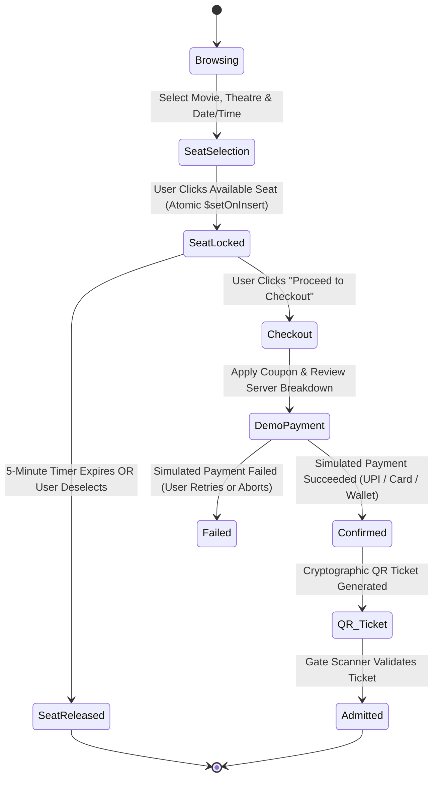

# CineVerse AI — End-to-End Booking Workflow

## 1. Booking State Machine

---

## 2. Step-by-Step Technical Execution

### Step 1: Real-Time Seat Selection & Atomic Locking
1. The user navigates to `/booking/:showId/seats`.
2. The client establishes a Socket.IO connection and joins room `show:{showId}`.
3. The server queries:
   - Screen seating topology from `Screen` model.
   - All confirmed bookings for the show from `Booking` model.
   - All active non-expired locks from `SeatLock` model (`expiresAt > now`).
4. When a seat is clicked, client sends `POST /api/v1/seats/:showId/lock` with `['C5']`.
5. The backend executes an atomic upsert operation:
   - If `SeatLock.findOne({ show, seatNumber: 'C5' })` exists and has not expired, returns `409 Conflict`.
   - Otherwise, inserts a lock with `expiresAt: Date.now() + 300000` (5 minutes).
6. The backend broadcasts `seat_locked` via Socket.IO to all other clients in the auditorium.
7. The client displays a dynamic countdown timer (`04:59`, `04:58`...).

### Step 2: Checkout & Server-Side Price Verification
1. User clicks **"Proceed to Checkout"**, navigating to `/checkout/:bookingId`.
2. The server verifies that the requesting user owns active locks for all specified seats.
3. The server recalculates pricing:
   - Base Price = Sum of tier prices (Standard ₹190, Premium ₹280, Recliner ₹450).
   - Convenience Fee = 10% of base price.
   - GST = 18% of convenience fee.
   - Coupon Discount = Validated strictly against `Coupon` collection (min spend, expiry, max discount cap).
   - Final Payable = `(Base + Fee + Taxes) - Discount`.
4. Client-submitted prices are *never* trusted.

### Step 3: Demo Payment Simulation & Idempotency
1. User selects demo method (`UPI Demo`, `Card Demo`, or `Wallet Demo`) on `/payment/:bookingId`.
2. Prominent banner is rendered: `"DEMO PAYMENT SIMULATION — NO REAL MONEY WILL BE CHARGED"`.
3. Client generates a unique UUID `idempotencyKey` and calls `POST /api/v1/payments/:bookingId/simulate`.
4. The server handles the transaction:
   - Checks if `Payment.findOne({ idempotencyKey })` already exists to prevent double charging.
   - Updates `Booking.status = 'confirmed'`.
   - Generates a unique `transactionReference` (e.g. `DEMO-TXN-1728...-XYZ`).
   - Awards 10 reward points per booked seat to the user's profile.
   - Deletes temporary `SeatLock` records.
   - Broadcasts `seat_booked` via Socket.IO so other users see the seats permanently booked.

### Step 4: Digital QR Ticket & Gate Scanner Verification
1. A confirmed ticket is rendered at `/ticket/:bookingId`.
2. A cryptographic verification token is generated using HMAC-SHA256 based on the booking reference and internal secret.
3. The QR barcode embeds only `{ bookingReference, verificationSecret }`—no plain-text user passwords or private card numbers are ever embedded.
4. At the cinema gate, authorized theatre staff open `/theatre/verify-ticket`:
   - Scans the QR code or types the reference.
   - The server validates that `Booking.status === 'confirmed'`.
   - Checks `Booking.isAdmitted`. If already `true`, returns `409 Conflict: "ALREADY ADMITTED — DUPLICATE ENTRY BLOCKED"`.
   - If valid, updates `isAdmitted: true`, logs `admittedAt: Date.now()`, and returns admission approval.
