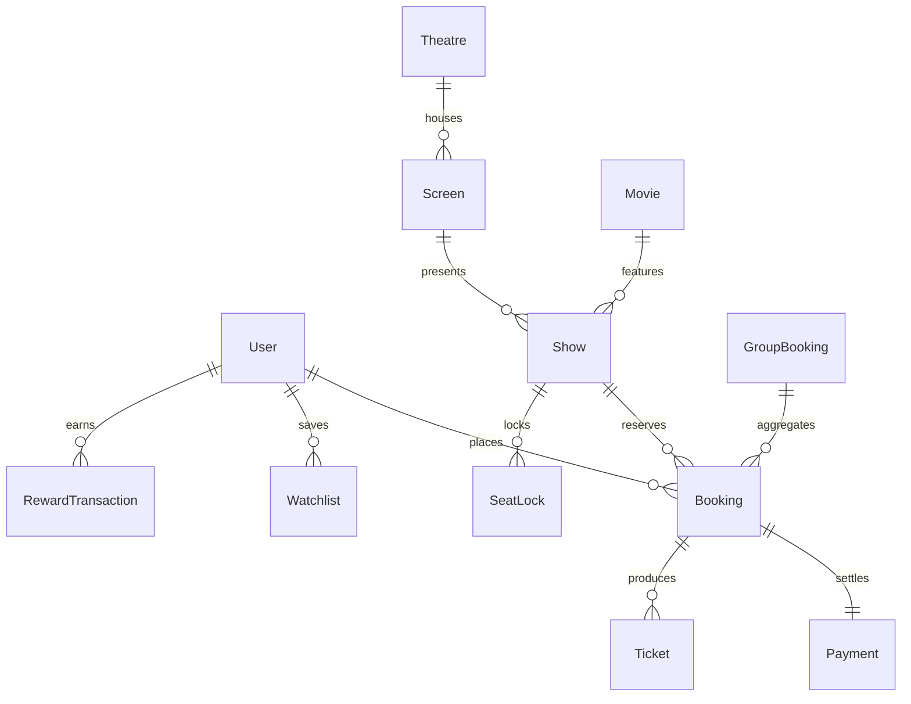

# CineVerse AI — Database Design & Data Models

## 1. Schema Architecture & Entity Relationship



---

## 2. Model Specifications

### 2.1 `User` Schema
- **Collection:** `users`
- **Fields:**
  - `name`: String, required.
  - `email`: String, required, unique, lowercase.
  - `phone`: String, optional.
  - `password`: String, required, hashed via `bcryptjs` (salt rounds: 10).
  - `role`: Enum `['user', 'admin', 'theatre']`, default: `'user'`. Enforced strictly on registration.
  - `theatre`: ObjectId ref `Theatre` (optional, assigned to theatre staff).
  - `rewardPoints`: Number, default: 0.
  - `tier`: Enum `['Bronze', 'Silver', 'Gold', 'VIP']`, default: `'Bronze'`.
  - `referralCode`: String, unique (e.g. `CINE-XXXXX`).
  - `referredBy`: ObjectId ref `User`.
  - `preferredCity`: String, default: `'Chennai'`.
- **Indexes:** `{ email: 1 }` (unique), `{ referralCode: 1 }` (sparse, unique).

---

### 2.2 `Movie` Schema
- **Collection:** `movies`
- **Fields:**
  - `title`: String, required.
  - `synopsis`: String, required.
  - `poster`: String, required.
  - `bannerImage`: String, optional.
  - `duration`: Number (minutes), required.
  - `certification`: Enum `['U', 'UA', 'A', 'R']`, default: `'UA'`.
  - `releaseDate`: Date, required.
  - `releaseStatus`: Enum `['now_showing', 'coming_soon', 'archived']`.
  - `languages`: Array of Strings (e.g. `['Tamil', 'Telugu', 'Hindi']`).
  - `genres`: Array of Strings (e.g. `['Action', 'Thriller']`).
  - `directors`: Array of Strings.
  - `cast`: Array of Objects (`{ name, role, avatar }`).
  - `trailerUrl`: String, optional.
  - `rating`: Object (`{ average: Number, count: Number }`).
- **Indexes:**
  - `{ title: 'text', synopsis: 'text' }` with `{ default_language: 'none', language_override: 'text_language' }`.
  - `{ releaseStatus: 1, releaseDate: -1 }`.

---

### 2.3 `Theatre` Schema
- **Collection:** `theatres`
- **Fields:**
  - `name`: String, required.
  - `city`: String, required (e.g. `'Chennai'`).
  - `state`: String, default: `'Tamil Nadu'`.
  - `pincode`: String, required.
  - `addressLine`: String, required.
  - `location`: GeoJSON Point Object:
    ```javascript
    location: {
      type: { type: String, enum: ['Point'], default: 'Point' },
      coordinates: [longitude, latitude] // [Number, Number]
    }
    ```
  - `amenities`: Array of Strings (e.g. `['Dolby Atmos', '4K RGB Laser', 'Recliner Seats', 'Cafeteria']`).
  - `phone`: String.
  - `email`: String.
  - `rating`: Object (`{ average: Number, count: Number }`).
- **Indexes:**
  - `{ location: '2dsphere' }` (Mandatory for MongoDB `$near` and `$geoWithin` geospatial queries).
  - `{ city: 1 }`.

---

### 2.4 `Screen` Schema
- **Collection:** `screens`
- **Fields:**
  - `theatre`: ObjectId ref `Theatre`, required.
  - `name`: String (e.g. `'Screen 1 - IMAX Laser'`).
  - `screenType`: Enum `['Standard', 'IMAX', '4DX', 'Dolby Cinema', 'Luxe']`.
  - `soundSystem`: String (e.g. `'Dolby Atmos 64 Channel'`).
  - `seatLayout`: Matrix configuration:
    - `rows`: Array of `{ rowName: String, category: String, seats: [{ seatNumber, isAisle, isWheelchair }] }`.
    - `totalSeats`: Number.
- **Indexes:** `{ theatre: 1 }`.

---

### 2.5 `Show` Schema
- **Collection:** `shows`
- **Fields:**
  - `movie`: ObjectId ref `Movie`, required.
  - `theatre`: ObjectId ref `Theatre`, required.
  - `screen`: ObjectId ref `Screen`, required.
  - `showDate`: Date, required.
  - `startTime`: String (e.g. `'18:30'`).
  - `endTime`: String (e.g. `'21:00'`).
  - `format`: Enum `['2D', '3D', 'IMAX 3D', '4DX']`.
  - `language`: String (e.g. `'Tamil'`).
  - `pricing`: `{ standard: Number, premium: Number, recliner: Number }`.
  - `status`: Enum `['scheduled', 'cancelled', 'completed']`.
- **Indexes:**
  - Compound Index: `{ movie: 1, showDate: 1, theatre: 1 }`.
  - `{ showDate: 1 }`.

---

### 2.6 `SeatLock` Schema (Atomic Concurrency Engine)
- **Collection:** `seatlocks`
- **Fields:**
  - `show`: ObjectId ref `Show`, required.
  - `seatNumber`: String, required (e.g. `'C5'`).
  - `user`: ObjectId ref `User`, required.
  - `socketId`: String, optional.
  - `createdAt`: Date, default `Date.now`.
  - `expiresAt`: Date, required (Configured as `now + 5 minutes`).
- **Indexes:**
  - Compound Unique Index: `{ show: 1, seatNumber: 1 }` (Ensures two users can never lock the same seat simultaneously).
  - TTL Index: `{ expiresAt: 1 }` with `{ expireAfterSeconds: 0 }` (Automatically drops expired locks).

---

### 2.7 `Booking` & `Payment` Schemas
- **Collection:** `bookings`
  - `bookingReference`: String, unique (e.g. `'CV-2026-A1B2C3'`).
  - `user`: ObjectId ref `User`.
  - `show`: ObjectId ref `Show`.
  - `seats`: Array of `{ seatNumber, category, price }`.
  - `pricing`: `{ basePrice, convenienceFee, taxes, discount, finalPayable }`.
  - `status`: Enum `['pending', 'confirmed', 'cancelled', 'expired']`.
  - `isAdmitted`: Boolean, default: `false`.
  - `admittedAt`: Date, optional.
  - `verificationSecret`: Cryptographic hash for QR ticket gate verification.
- **Collection:** `payments`
  - `booking`: ObjectId ref `Booking`.
  - `user`: ObjectId ref `User`.
  - `amount`: Number.
  - `method`: Enum `['UPI', 'CARD', 'WALLET', 'NETBANKING']`.
  - `status`: Enum `['success', 'failed', 'pending', 'refunded']`.
  - `transactionReference`: String, unique (e.g. `'DEMO-TXN-1728...-XYZ'`).
  - `idempotencyKey`: String, sparse index.
